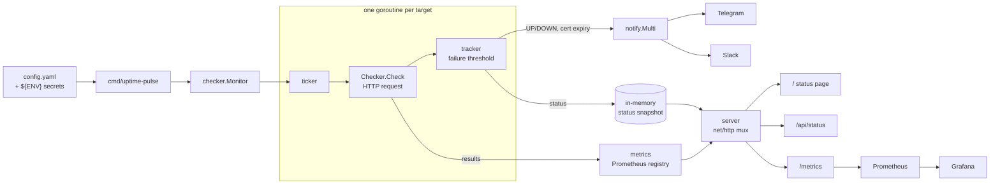

# uptime-pulse

[](https://github.com/rakaprad/uptime-pulse/actions/workflows/ci.yml)
[](LICENSE)

A small, self-hosted uptime and health monitor written in Go. It checks HTTP(S)
endpoints on a schedule, alerts Telegram or Slack when a target goes down or comes
back, warns before TLS certificates expire, and exposes everything as Prometheus
metrics, a status page and a JSON API.

## Why

Hosted uptime services are convenient, but they can't reach internal endpoints, they
cost money per check, and their data stays in someone else's dashboard. A full
monitoring stack is more than you need when the question is "is this URL healthy?".

uptime-pulse sits in between. It's one static binary (or a small distroless image)
configured by a single YAML file. Its metrics go into the Prometheus/Grafana you
already run, and it sends alerts straight to the chat your team already reads.

## Features

- **HTTP(S) checks** with per-target method, interval, timeout, expected status code
  and an optional response-body keyword.
- **Concurrent scheduling**: each target gets its own goroutine and ticker, so a
  slow target never delays the others.
- **Anti-flapping alerts**: a target is declared DOWN only after N consecutive
  failures (`failure_threshold`). You get one alert per state change, not one per
  failed check.
- **TLS expiry warnings**: you get one alert when a certificate enters the
  warning window, and the warning re-arms after the certificate is renewed.
- **Notifiers**: Telegram (including forum topics via `message_thread_id`) and Slack
  incoming webhooks, behind a small `Notifier` interface.
- **Prometheus metrics** on `/metrics`, a **status page** on `/`, a **JSON API** on
  `/api/status`, and a liveness probe on `/healthz`.
- **Secrets from the environment**: `${ENV_VAR}` references in the config are
  expanded at startup.
- **Operational basics**: graceful shutdown on SIGTERM, structured JSON logs (`log/slog`),
  and a non-root, read-only container.

## Architecture



| Package | Responsibility |
|---|---|
| `cmd/uptime-pulse` | Flags, logging, wiring, signal handling, graceful shutdown |
| `internal/config` | YAML parsing, `${ENV}` expansion, defaults, validation |
| `internal/checker` | HTTP check, state machine (threshold logic), per-target scheduling |
| `internal/notify` | `Notifier` interface, Telegram and Slack implementations |
| `internal/metrics` | Prometheus collectors on a dedicated registry |
| `internal/server` | Status page (`html/template` + `go:embed`), JSON API, health, metrics |

## Quickstart

### Binary

```sh
git clone https://github.com/rakaprad/uptime-pulse && cd uptime-pulse
cp config.example.yaml config.yaml
make build
./bin/uptime-pulse -config config.yaml
# open http://localhost:8080
```

### Docker Compose (with Prometheus and Grafana)

```sh
cp .env.example .env        # optional: add Telegram/Slack credentials
make compose-up
```

| Service | URL |
|---|---|
| Status page | http://localhost:8080 |
| Prometheus | http://localhost:9090 (alerts under *Alerts*) |
| Grafana | http://localhost:3000 (admin / `GF_ADMIN_PASSWORD`, dashboard *uptime-pulse*) |

The stack uses [`deploy/uptime-pulse.yaml`](deploy/uptime-pulse.yaml), which also
monitors the Prometheus and Grafana containers.

### Kubernetes (Helm)

```sh
kubectl create namespace monitoring
kubectl -n monitoring create secret generic uptime-pulse-notifiers \
  --from-literal=TELEGRAM_BOT_TOKEN=... \
  --from-literal=TELEGRAM_CHAT_ID=...

helm install uptime-pulse deploy/helm/uptime-pulse -n monitoring \
  --set existingSecret=uptime-pulse-notifiers \
  --set serviceMonitor.enabled=true      # if you run the Prometheus Operator
```

Targets are set under `config:` in [`values.yaml`](deploy/helm/uptime-pulse/values.yaml).
The pod restarts automatically when the config changes, because the ConfigMap
checksum is stored as a pod annotation.

## Configuration

See [`config.example.yaml`](config.example.yaml) for a complete example.

### Global

| Key | Default | Description |
|---|---|---|
| `listen` | `:8080` | HTTP listen address |
| `log_level` | `info` | `debug`, `info`, `warn`, `error` |
| `log_format` | `json` | `json` or `text` |
| `cert_warning_days` | `14` | Alert once when a TLS certificate expires within this many days |
| `defaults.*` | see below | Defaults for every target field marked * |

### Targets (`targets[]`)

| Key | Default | Description |
|---|---|---|
| `name` | required | Unique name, used as the `target` metric label |
| `url` | required | Absolute `http://` or `https://` URL |
| `method` * | `GET` | HTTP method |
| `interval` * | `30s` | Time between checks (Go duration) |
| `timeout` * | `10s` | Per-request timeout. Must be shorter than `interval` |
| `expected_status` * | `200` | Status code that counts as healthy |
| `keyword` | none | Response body (first 1 MiB) must contain this string |
| `failure_threshold` * | `3` | Consecutive failures before the target is declared DOWN |

### Notifiers

A notifier is enabled only when its required fields are non-empty. If you leave the
environment variable unset, that notifier is disabled.

| Key | Description |
|---|---|
| `notifiers.telegram.bot_token` | Bot token from @BotFather |
| `notifiers.telegram.chat_id` | Target chat or group id (e.g. `-1001234567890`) |
| `notifiers.telegram.message_thread_id` | Optional topic id in a forum-enabled group |
| `notifiers.slack.webhook_url` | Slack incoming webhook URL |

`${VAR}` is expanded inside YAML values after parsing, so a secret that contains
YAML syntax can't change the structure of the config. A bare `$` is left as-is.
Unknown keys are rejected, so a typo like `intervall` fails at startup instead of
being silently ignored.

## Metrics

| Metric | Type | Labels | Description |
|---|---|---|---|
| `uptime_pulse_up` | gauge | `target` | `1` if the last check succeeded, else `0` |
| `uptime_pulse_check_duration_seconds` | histogram | `target` | Check latency, including body transfer |
| `uptime_pulse_cert_expiry_days` | gauge | `target` | Days until the leaf certificate expires (HTTPS only) |
| `uptime_pulse_checks_total` | counter | `target`, `result` | Checks by `success` / `failure` |

The standard Go runtime and process metrics are also exported. Example alert rules
are in [`deploy/prometheus/alerts.yml`](deploy/prometheus/alerts.yml) and a dashboard in
[`deploy/grafana/dashboards`](deploy/grafana/dashboards).

## HTTP endpoints

| Path | Description |
|---|---|
| `/` | Status page, refreshes every 15 seconds |
| `/api/status` | JSON with the current state of every target |
| `/metrics` | Prometheus metrics |
| `/healthz` | Liveness: returns `200 ok` while the process is serving |

## Screenshots

> Screenshots of the status page and the Grafana dashboard will be added here.

## Development

```sh
make test     # go test -race with coverage
make lint     # go vet + golangci-lint
make run      # run with ./config.yaml
make docker   # build the container image
```

CI (`.github/workflows/ci.yml`) runs vet, golangci-lint, race-enabled tests, a build
and `helm lint`. On pushes to `main` it also builds a multi-arch image and pushes it
to `ghcr.io/rakaprad/uptime-pulse`.

## Design notes and limitations

- **State is in memory.** After a restart every target starts as `unknown`. A target
  that is still down after the restart is reported as DOWN again once it hits the
  threshold, but a target that recovered during the restart does not trigger a
  recovery alert.
- **Single replica.** Two replicas would send duplicate alerts. For HA, rely on the
  Prometheus alert rules, which are stateless.
- **No connection reuse.** Each check opens a fresh connection, so DNS, TCP and TLS
  failures are detected instead of being hidden by keep-alive. The latency
  numbers include connection setup.

## Roadmap

- [ ] More check types: TCP port, DNS resolution, ICMP
- [ ] Additional notifiers: Discord, generic webhook, email
- [ ] Config hot reload on SIGHUP
- [ ] Optional persistence of last state across restarts
- [ ] Response-time SLO thresholds (degraded state)
- [ ] Per-target custom headers (e.g. auth tokens)

## License

[MIT](LICENSE) © 2026 Raka Pradipta
